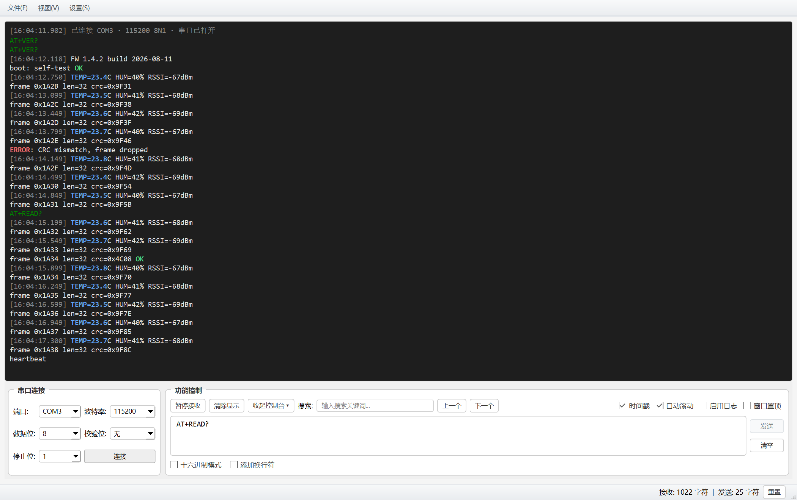
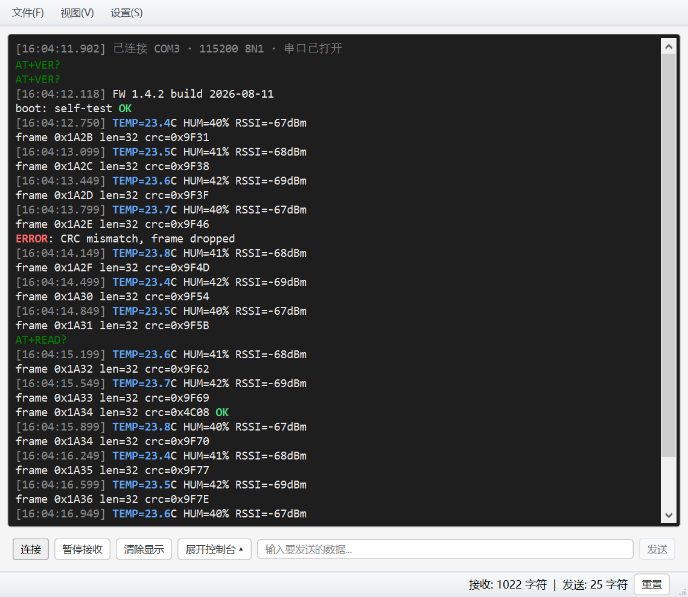
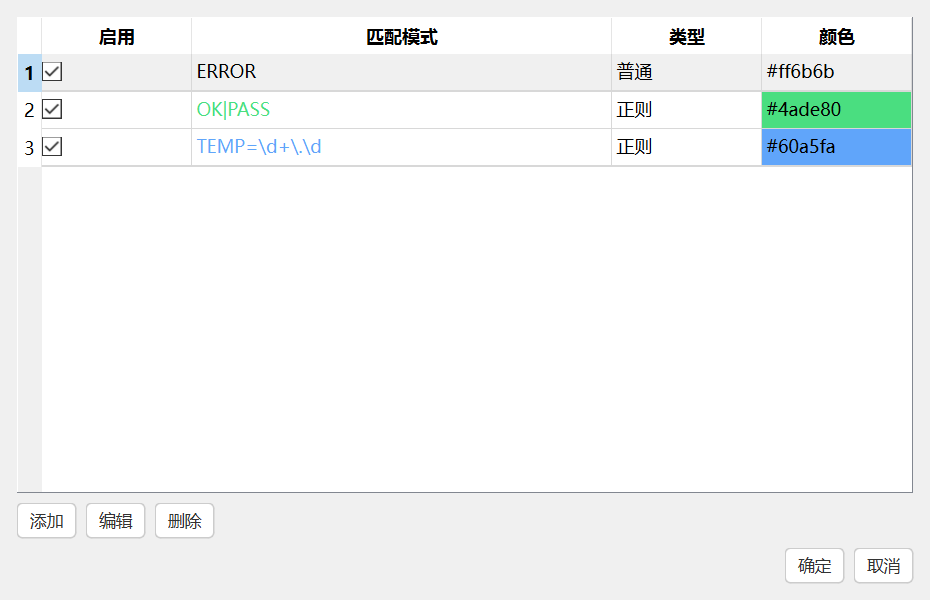

# SerialPortTool 串口调试工具

[English](README.md) · **简体中文**

基于 PySide6 的串口监视工具：连接、观察、搜索、高亮、记录日志。



项目是按一份正式的需求文档重写的：界面布局沿用原工具，实现全部重写并做了分层，
因此几乎全部行为都能在没有真实串口、没有显示器的环境下测试。

## 功能

- **端口发现** —— 后台轮询端口列表并原地刷新，热插拔后当前选中项不会丢失。
- **连接参数** —— 端口、波特率（9600 … 921600）、数据位、校验位、停止位，打开前先校验。
- **接收** —— 工作线程做阻塞读取，成批交给界面。
- **发送** —— 文本（UTF-8）或 HEX，可选自动追加换行。所有写操作都经工作线程持有的
  队列执行，GUI 线程从不直接碰端口句柄。
- **显示** —— 三种消息类型（系统 / 发送 / 接收），每个数据块首行带毫秒级时间戳；
  内容一律转义，设备输出 `<b>` 这类文本会原样显示而不是被当成标记解析。
- **高亮** —— 自定义规则，支持普通字符串与正则，每条可单独设颜色、单独开关，
  改完即时生效，不需要重连。
- **搜索** —— 向前 / 向后查找，到末尾时给出回绕提示。
- **暂停** —— 只停渲染、继续缓冲，暂停期间的数据一条不丢。
- **会话日志** —— 带时间戳的行追加到程序同级的 `log/log_YYYYMMDD_HHMMSS.log`，
  每次写入即时落盘。
- **容量上限** —— 100 KB … 10 MB 或不限制；超出时按块边界丢弃最早的内容，
  剩余文本的颜色与时间戳不受影响。
- **控制台折叠** —— 窗口窄于 1300 px 时，设置面板自动收成一行精简条，
  连接 / 暂停 / 清除 / 发送仍然触手可及（`` Ctrl+` `` 可手动切换）。
- **配置持久化** —— 连接参数、显示选项、显示字体、全部高亮规则都会在下次启动时恢复。

## 界面截图

| 窄窗口——控制台收成一行 | 高亮规则 |
|---|---|
|  |  |

## 环境要求

- Python 3.10+
- PySide6
- pyserial

```bash
pip install -r requirements.txt
```

## 安装

三种拿到可运行程序的方式，按最终用户的省事程度递增：

| 形态 | 产物 | 适合谁 |
|---|---|---|
| 源码运行 | — | 开发者，`python main.py` |
| 绿色单文件 | `SerialPortTool.exe`（43 MB） | 拷给同事、放 U 盘直接双击 |
| Windows 安装包 | `SerialPortTool-1.0.0-setup.exe`（45 MB） | 正式分发：开始菜单快捷方式 + 卸载项 |

两个二进制都挂在[最新发布](https://github.com/gyluq/SerialPortTool/releases/latest)的附件里，不入库——它们是构建产物，生成方式见[打包](#打包)。

安装包是**当前用户**安装，装到 `%LOCALAPPDATA%\Programs\SerialPortTool`，不弹 UAC。
这不是随手选的：程序会把 `log\` 写在 exe 同级目录，装进 `Program Files` 普通用户写不进去。

## 运行

```bash
python main.py
```

## 测试

```bash
pip install -r requirements-dev.txt
python -m pytest
```

175 个用例，约两秒跑完。整套测试无需显示器（`QT_QPA_PLATFORM=offscreen`）、
无需硬件：串口由假传输对象替身，配置写进临时 ini 文件，不碰真实的环境。

## 性能基准

```bash
python tools/bench_receive.py                       # 全部进程内场景
python tools/bench_receive.py --only stream --total-mb 8
python tools/bench_receive.py --only loss --limit 1MB
python tools/bench_receive.py --only loop --total-mb 4   # 读线程 + 驱动缓冲，端到端
```

场景说明：`single`（单次调用最大数据量）、`stream`（持续吞吐 MB/s）、
`loss`（按序号核对空洞）、`pause`（暂停缓冲上限）、`memory`（各容量档位的 RSS）、
`send`（大段发送）、`loop`（走真实读线程的端到端链路）。

本机实测：持续接收 **0.60–0.65 MB/s**（约 921600 波特率的 6 倍），
满速灌 10 秒**零丢字节**。

## 架构

```
main.py                    入口
serial_tool/
├── core/                  纯 Python，不 import 任何 Qt
│   ├── params.py          连接参数、校验、标签映射
│   ├── codec.py           文本编解码、HEX 解析与格式化
│   ├── render.py          行 → HTML 片段（全项目唯一的转义点）
│   ├── highlight.py       规则模型与匹配引擎（只返回区间）
│   ├── retention.py       决定从头部丢弃多少个块
│   ├── counters.py        收发字符计数
│   ├── config.py          配置 dataclass 与字典序列化
│   ├── layout.py          控制台断点与窗口最小尺寸
│   ├── logfile.py         日志文件命名与逐行写入
│   └── session.py         端口枚举、传输抽象、写队列
├── ui/                    PySide6 外壳
│   ├── main_window.py     布局、信号绑定、渲染
│   ├── highlighter.py     把 core.highlight 适配成 QSyntaxHighlighter
│   ├── rules_dialog.py    规则编辑对话框
│   ├── settings_store.py  QSettings ↔ core.config 适配
│   └── styles.py          样式表常量
└── tests/
```

分层的理由只有一个：`core` 决定**显示什么、什么时候显示**，`ui` 只负责画出来。
转义、配色、裁剪边界、规则匹配全部在不开窗口的情况下由测试断言。

`core.session.SerialSession` 接受任何实现了 `Transport` 协议
（`is_open`、`read`、`write`、`close`）的对象，整条收发链路就是靠
`tests.fakes.FakeTransport` 跑通的。

## 打包

### 绿色单文件

```bash
pip install -r requirements-dev.txt
pyinstaller packaging.spec
```

`packaging.spec` 会把 `icon.png`、`icon.ico` 一起打进包，把 `icon.ico` 与
`version_info.txt` 作为 exe 资源嵌入，并排除用不到的 Qt 模块。产物是一个
自包含的 `dist/SerialPortTool.exe`（约 43 MB），目标机器什么都不用装。
Linux/macOS 上同一份 spec 会产出 `dist/SerialPortTool`。

### Windows 安装包

需要 [Inno Setup 6](https://jrsoftware.org/isdl.php)
（`winget install --id JRSoftware.InnoSetup -e`）。然后一条命令跑完整条链——
测试、打 exe、编译安装包：

```powershell
powershell -ExecutionPolicy Bypass -File tools\build_installer.ps1
```

产物是 `dist/SerialPortTool-1.0.0-setup.exe`（约 45 MB）。只想重编安装包时，
单独跑 `iscc installer\SerialPortTool.iss` 即可。

安装包做了什么：

| | |
|---|---|
| 安装位置 | `%LOCALAPPDATA%\Programs\SerialPortTool` |
| 提权 | 无——当前用户安装，不弹 UAC |
| 快捷方式 | 开始菜单必建，桌面可选 |
| 卸载 | 走 Windows 标准卸载项；删除 `log\` 前会先询问 |

### 图标与截图

两者都是脚本生成，不要手改：

```bash
python tools/make_icon.py          # icon.png + 九帧 icon.ico
python tools/make_screenshots.py   # 生成 docs/images/*.png 供两份 README 使用
```

给打包者的一条笔记：`core/config.py` 里的 `app_base_dir()` 在冻结环境下按
`sys.executable` 定位数据目录。单文件包会解压到临时目录 `_MEIxxxx`，退出即删，
若用 `__file__` 推导日志路径，会静默丢掉每一份记录。

## 许可

MIT，见 `LICENSE`。
